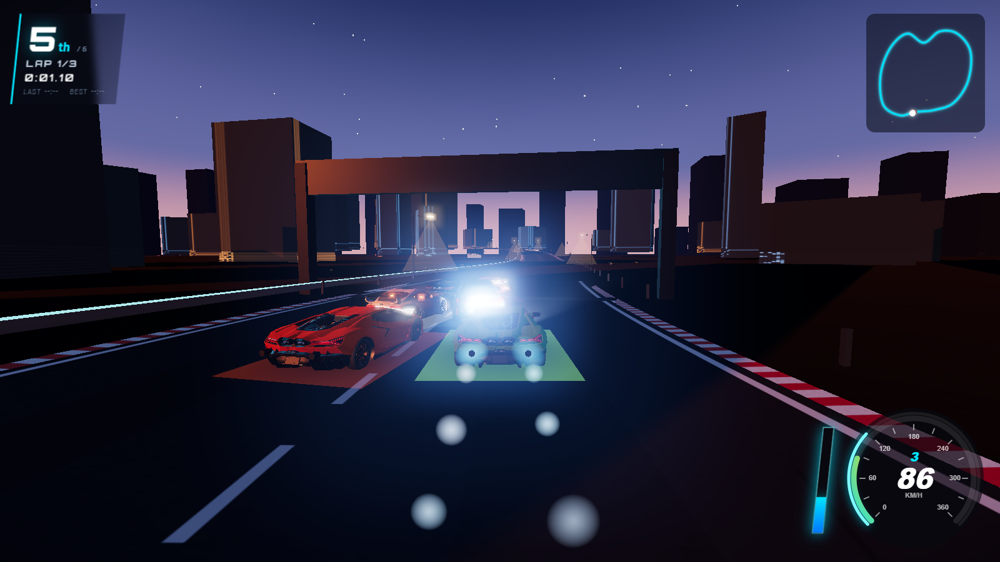
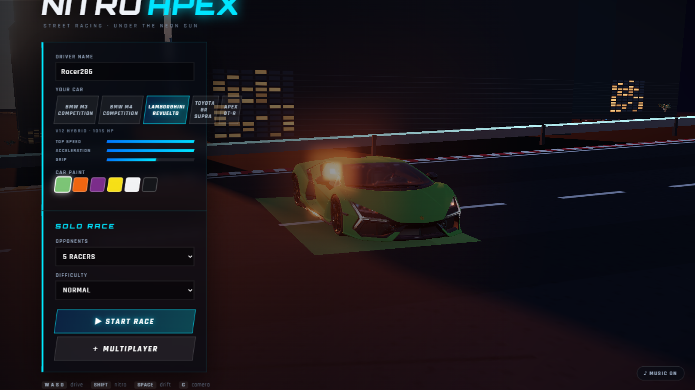

<div align="center">

# 🏁 APEX NITRO

### *High-Octane 3D Street Racing in Your Browser*

[](https://threejs.org/)
[](https://nodejs.org/)
[](https://developer.mozilla.org/en-US/docs/Web/API/WebSockets_API)
[](https://workers.cloudflare.com/)
[](LICENSE)

<br/>

**Apex Nitro** is an arcade 3D street-racing game inspired by *Asphalt 9* and *Need for Speed*. Built entirely on modern web technologies with WebGL (Three.js), procedural Web Audio, and real-time LAN & Cloudflare multiplayer.

**No game engine downloads · No complex build pipelines · Pure browser adrenaline**

</div>

---

## 📸 In-Game Action & Screenshots

<div align="center">

### 🏎️ Race Start & Dusk City Circuit
*High-speed grid launch with AI opponents, dynamic neon skyline, and real-time HUD.*



<br/><br/>

### 🛠️ Showroom & Supercar Customization
*Interactive garage with custom paint finishes, vehicle stats, and race mode selection.*



</div>

---

## ✨ Features

- 🏎️ **Supercar & Sport Roster**
  - **Lamborghini Revuelto** — 1015 HP V12 Hybrid Hypercar (Top Speed: 352 km/h)
  - **Apex GT-R** — 780 HP Track Monster (Top Speed: 317 km/h)
  - **BMW M4 Competition** — 510 HP Turbo Coupe (Top Speed: 299 km/h)
  - **BMW M3 Competition** — 510 HP Sport Sedan (Top Speed: 295 km/h)
  - **Toyota GR Supra** — 382 HP Agile Drift Coupe (Top Speed: 290 km/h)
  - *Full custom paint options, real-time stat bars, and detailed 3D chassis meshes.*

- ⚡ **Arcade Physics & N₂O Nitro**
  - Handbrake power-drifts with responsive counter-steering, tire skid marks, and smoke particles.
  - Multi-stage N₂O boost with exhaust flame VFX, dynamic FOV kick, and chromatic aberration speed-warp.
  - Slipstream drafting mechanics and wall-bounce collision response.

- 🌆 **Atmospheric Dusk Circuit**
  - Procedurally generated dusk city with glowing skyscrapers, neon guard-rails, overhead highway gantries, and street lights.
  - Custom sunset sky shader, dynamic fog, and starry horizon.

- 🌐 **Real-Time Multiplayer**
  - **Local LAN Mode**: Built-in Node.js WebSocket server with 20 Hz state relay and snapshot interpolation.
  - **Cloudflare Edge Mode**: Powered by Cloudflare Workers & Durable Objects for global low-latency multiplayer rooms.
  - Instant 4-character room codes, player nametags, and live synchronized leaderboards.

- 🎵 **100% Procedural Web Audio**
  - Zero external MP3/WAV downloads required!
  - Real-time engine synthesis linked to RPM and throttle, tire screeches, turbo blow-off, nitro whoosh, and retro synthwave soundtrack generated on-the-fly via the Web Audio API.

- 📱 **Cross-Platform & Responsive**
  - Full desktop keyboard support + automatic touch controls for phones and tablets.

---

## 🎮 Controls

| Key / Input | Action |
|---|---|
| <kbd>W</kbd> / <kbd>▲</kbd> | Throttle / Accelerate |
| <kbd>S</kbd> / <kbd>▼</kbd> | Brake / Reverse |
| <kbd>A</kbd> / <kbd>◄</kbd> | Steer Left |
| <kbd>D</kbd> / <kbd>►</kbd> | Steer Right |
| <kbd>SHIFT</kbd> | **Nitrous Oxide (N₂O) Boost** |
| <kbd>SPACE</kbd> | **Handbrake / Drift** |
| <kbd>C</kbd> | Switch Camera (Chase / Hood) |
| <kbd>R</kbd> | Reset Car to Track |
| <kbd>ESC</kbd> | Pause (Solo Race) |
| <kbd>M</kbd> | Toggle Audio / Music |
| *Touch UI* | On-screen steering, pedals, and nitro buttons on mobile |

---

## 🚀 Quick Start

### Option 1: One-Click Launcher (Windows)
Simply double-click:
```bat
start-game.bat
```
This automatically launches the server and opens your default browser at `http://localhost:3000`.

---

### Option 2: Node.js (Terminal)

1. **Clone the repository:**
   ```bash
   git clone https://github.com/daksh043/Apex-nitro.git
   cd Apex-nitro
   ```

2. **Install dependencies:**
   ```bash
   npm install
   ```

3. **Start the local server:**
   ```bash
   npm start
   ```

4. **Play:**
   Open [http://localhost:3000](http://localhost:3000) in any modern browser (Chrome, Edge, Firefox, Safari).

---

### Option 3: Cloudflare Workers (Edge Deployment)

To run or deploy multiplayer rooms on Cloudflare's edge:
```bash
# Run local dev server with Durable Objects
npm run cf:dev

# Deploy to Cloudflare
npm run deploy
```

---

## 👥 How Multiplayer Works

1. Start the server on your computer. The console will display both your **Local** and **Network** URL (e.g., `http://192.168.1.x:3000`).
2. Friends connected to the same Wi-Fi network open the **Network URL** on their laptop, tablet, or phone.
3. Click **Multiplayer → CREATE ROOM** to generate a 4-letter room code.
4. Friends click **JOIN ROOM** and enter your code.
5. The host selects **START RACE** — all players launch together with synchronized grid positions, countdowns, and real-time ghost interpolation!

---

## 🧱 Project Structure

```
Apex-nitro/
├── public/
│   ├── css/
│   │   └── style.css       # NFS-style UI styling & HUD overlay
│   ├── js/
│   │   ├── main.js         # Game loop, race state machine, camera & input
│   │   ├── car.js          # Physics, handling, AI drivers & vehicle configs
│   │   ├── track.js        # Procedural circuit, city skyline & props
│   │   ├── hud.js          # Speedometer, minimap, lap timers & standings
│   │   ├── fx.js           # Particle emitters, tire marks, nitro flames & post-fx
│   │   ├── net.js          # Multiplayer client & snapshot interpolation
│   │   ├── audio.js        # Procedural synthwave music & engine audio synthesis
│   │   └── textures.js     # Procedural canvas textures (asphalt, facades, etc.)
│   ├── models/             # 3D vehicle models (GLB / OBJ)
│   └── index.html          # Main HTML entry point
├── src/
│   └── room-do.js          # Cloudflare Durable Object for multiplayer room state
├── server.js               # Node.js static server & WebSocket relay
├── worker.js               # Cloudflare Workers entry point
├── wrangler.jsonc          # Cloudflare deployment config
├── start-game.bat          # Windows double-click runner
└── package.json
```

---

## 🛠️ Tech Stack

- **Graphics**: [Three.js](https://threejs.org/) (WebGL PBR shaders, bloom, depth fog, dynamic shadow maps)
- **Audio**: Web Audio API (procedural frequency modulation synth, white noise tire skid generator)
- **Networking**: Node.js `ws` + Cloudflare Workers Durable Objects
- **Architecture**: Zero-build vanilla ES modules with native browser import maps

---

## 📄 License

This project is licensed under the [MIT License](LICENSE).
Feel free to fork, customize, and build your own circuits and vehicles!
